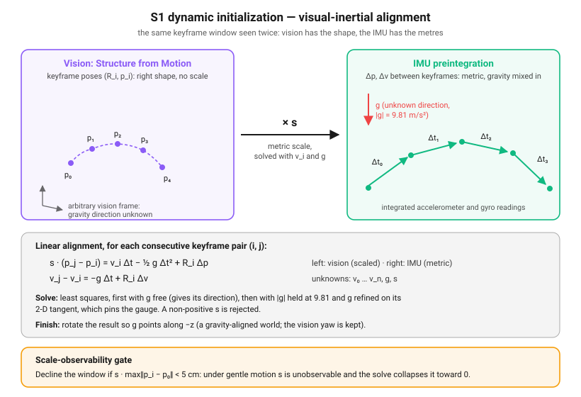

import { Aside } from '@astrojs/starlight/components';

**A filter has to start somewhere.** 
Visual-Inertial Odometry is a highly non-linear, recursive estimation process. For its linearizations (first-order Taylor-series expansions / Jacobians) to remain valid, the filter must be initialized incredibly close to the true initial state.

S1 bootstraps the initial state — attitude, gyro/accel biases, gravity direction, and (for a moving dynamic start) metric scale — **and** seeds the initial covariance $\mathbf{P}_0$ that represents the filter's starting uncertainty. 

If S1 fails, it introduces two severe failure modes: returning a *confidently wrong* state when the motion cannot observe it, or seeding $\mathbf{P}_0$ too tight on the directions the initialization could not physically observe. the first causes immediate divergence; the second quietly poisons the EKF with structural over-confidence from $t = 0$.

---

## 1. Static Initialization (Gravity-Leveling)

When the vehicle starts stationary on the ground, S1 detects a quiet window by checking that the standard deviation of gyroscope and accelerometer readings is below a strict threshold. It then averages the raw readings over $M$ samples:

$$
\mathbf{a}_{\text{avg}} = \cfrac{1}{M} \sum_{i=1}^M \tilde{\mathbf{a}}_i, \qquad \mathbf{w}_{\text{avg}} = \cfrac{1}{M} \sum_{i=1}^M \tilde{\mathbf{w}}_i
$$

### A. Gyroscope Bias Seeding
Since the vehicle is stationary ($\boldsymbol{\omega}_{\text{true}} = \mathbf{0}$), any measured angular rate is pure bias. We seed the gyroscope bias directly:

$$
\mathbf{b}_g = \mathbf{w}_{\text{avg}}
$$

### B. Attitude Seeding from Gravity (Leveling)
Since the accelerometer only senses gravity when static, the mean specific force vector $\mathbf{a}_{\text{avg}}$ points exactly opposite to gravity. We use this to compute the initial roll and pitch of the vehicle relative to gravity, represented by the rotation matrix $\mathbf{R}_{I}^{W}$ (IMU-to-World transformation).

We define the vertical z-axis of the IMU frame in the world frame as:

$$
\mathbf{z}_I = \cfrac{\mathbf{a}_{\text{avg}}}{\|\mathbf{a}_{\text{avg}}\|}
$$

To build a full orthogonal rotation matrix $\mathbf{R}_{I}^{W}$ that maps gravity $\mathbf{g}_W = [0, 0, -g]^T$ to $\mathbf{a}_{\text{avg}}$ (or conversely, aligns $\mathbf{z}_I$ with gravity), we use Gram-Schmidt orthonormalization:

1.  **Temporary Horizontal Axis**: Assume an arbitrary temporary horizontal x-axis: $\mathbf{x}_{\text{tmp}} = [1, 0, 0]^T$.
2.  **Orthogonal Y Axis**: Compute the orthogonal y-axis via the cross product: $\mathbf{y}_I = \cfrac{\mathbf{z}_I \times \mathbf{x}_{\text{tmp}}}{\|\mathbf{z}_I \times \mathbf{x}_{\text{tmp}}\|}$ (where $\times$ is the cross-product).
3.  **True Orthogonal X Axis**: Compute the true orthogonal x-axis: $\mathbf{x}_I = \mathbf{y}_I \times \mathbf{z}_I$.
4.  **Assemble Rotation**: The initial rotation matrix is then:

$$
\mathbf{R}_{I}^{W} = \begin{bmatrix} \mathbf{x}_I & \mathbf{y}_I & \mathbf{z}_I \end{bmatrix}
$$

*   **Orthonormalization Singularity & Fallback**: If the gravity vector $\mathbf{z}_I$ is parallel or near-parallel to the temporary horizontal axis $\mathbf{x}_{\text{tmp}} = [1, 0, 0]^T$ (which happens if the drone is tilted exactly $90^\circ$ on its side), the cross product $\mathbf{z}_I \times \mathbf{x}_{\text{tmp}}$ collapses to zero, making step 2 undefined. Cortex solves this by checking the norm of $\mathbf{z}_I \times \mathbf{x}_{\text{tmp}}$. If it falls below a strict threshold (e.g., $0.1$), it dynamically falls back to using $\mathbf{x}_{\text{tmp}} = [0, 1, 0]^T$ as the temporary axis, ensuring the basis construction is always well-conditioned.

Because gravity has zero horizontal components, **static accelerometer readings can only observe the two tilt axes (roll and pitch)**. The heading (**yaw**) is completely unobservable relative to gravity. Yaw is a free gauge direction; we can set it to an arbitrary starting value ($0^\circ$), but the filter must be told that this yaw direction is completely unobserved.

---

## 2. Dynamic Initialization (Visual-Inertial Alignment)

If the vehicle starts in motion (e.g., hand-launched or already flying), static gravity-leveling is impossible because world-frame acceleration $\mathbf{a}_{\text{world}} \neq \mathbf{0}$. S1 must perform a **Visual-Inertial Alignment** over a short sliding window (usually 1 to 2 seconds) to find metric scale.

1.  **Structure from Motion (SfM)**: The visual frontend tracks features over multiple frames and runs a bundle-adjustment to recover the **keyframe poses $(\mathbf{R}_i, \mathbf{p}_i)$, with positions known only up to a scale factor $s$**.
2.  **IMU Preintegration**: The IMU Simple-integrated velocities and positions are double-integrated over the same intervals to compute the metric displacement and velocity change $\Delta \mathbf{p}$ and $\Delta \mathbf{v}$ between consecutive keyframes.
3.  **Linear Scale Alignment**: We set up a linear system matching the visual translations to the double-integrated IMU displacements, solving for the **metric scale $s$, the per-keyframe velocities $\mathbf{v}_i$, and the gravity vector $\mathbf{g}$**. The scale multiplies the SfM displacement; the IMU terms are already metric. For each consecutive keyframe pair $(i, j)$ separated by $\Delta t$:

$$
\begin{aligned}
s\,(\mathbf{p}_j - \mathbf{p}_i) &= \mathbf{v}_i \Delta t - \tfrac{1}{2} \mathbf{g} \Delta t^2 + \mathbf{R}_i \Delta \mathbf{p} \\
\mathbf{v}_j - \mathbf{v}_i &= -\mathbf{g} \Delta t + \mathbf{R}_i \Delta \mathbf{v}
\end{aligned}
$$

### The Scale-Observability Cliff
Under gentle motion (such as hover or pure rotation), the acceleration vector does not change. In this regime, the system of equations is **ill-conditioned**, and the metric scale $s$ is physically unobservable. 

To prevent the EKF from starting with a confidently wrong metric scale, Cortex runs a **Singular Value Decomposition (SVD) condition check** on the alignment matrix $\mathbf{A}$. If the ratio of the maximum to minimum singular values (condition number) exceeds a strict threshold (usually 100), the dynamic initialization is safely **declined**, forcing the system to wait for sufficient acceleration excitation.

---

## 3. The Covariance Seed: What the Window Determines

The initial covariance $\mathbf{P}_0$ is the filter's starting uncertainty. Until #609 cortex
seeded it isotropic, $\mathbf{P}_0 = \sigma^2 \mathbf{I}$ with $\sigma = 0.1$ on every core state, and
that prior made a claim the window doesn't support: that tilt and accelerometer bias are
independent.

### Tilt and bias are one quantity at rest

At rest the accelerometer reads $\mathbf{f} = \mathbf{R}^T g\,\mathbf{e}_z + \mathbf{b}_a + \mathbf{n}$.
A seed that takes "up" $\hat{\mathbf{u}}$ from the mean $\bar{\mathbf{f}}$ with $\mathbf{b}_a = 0$
leaves a tilt error ($\mathbf{R} = \hat{\mathbf{R}}\,\mathrm{Exp}(\delta\boldsymbol\theta)$) of

$$
\delta\boldsymbol\theta_\perp = [\hat{\mathbf{u}}]_\times (\mathbf{b}_a + \bar{\mathbf{n}}) / g ,
$$

so the window knows the tilt and the horizontal bias only as one sum. With $\mathbf{b}_a \sim
\mathcal{N}(0, \sigma_{ba}^2 \mathbf{I})$ and the mean's own error $\sigma_f$ the seed's block is

$$
\mathbf{P}_{\theta\theta} = \tfrac{\sigma_{ba}^2 + \sigma_f^2}{g^2}(\mathbf{I} - \hat{\mathbf{u}}\hat{\mathbf{u}}^T) + \sigma_\psi^2 \hat{\mathbf{u}}\hat{\mathbf{u}}^T,\quad
\mathbf{P}_{\theta b} = \tfrac{\sigma_{ba}^2}{g}[\hat{\mathbf{u}}]_\times,\quad
\mathbf{P}_{bb} = \sigma_{ba}^2(\mathbf{I} - \hat{\mathbf{u}}\hat{\mathbf{u}}^T) + \sigma_\parallel^2 \hat{\mathbf{u}}\hat{\mathbf{u}}^T .
$$

The isotropic prior put 99% of the sum in tilt, because 0.1 rad of tilt is 1 m/s² of gravity
against 0.1 m/s² of bias. Since #609 S1 writes this block on a static seed
(`stages::s1_initialization::tilt_bias_prior`), with:

| Term | Value | Why |
| :--- | :--- | :--- |
| $\sigma_{ba}$ | 0.2 m/s² (`VioConfig::accel_bias_prior_sigma`) | EuRoC's ground-truth bias is 0.09–0.20 m/s² (V1_01's 0.55 is suspect, below) |
| $\sigma_f$ | the window's scatter over $\sqrt N$, or $\sigma_a/\sqrt{T}$ if larger | rotor vibration (0.03–0.28 m/s² per sample on EuRoC) |
| bias along up | seeded from $\lvert\bar{\mathbf{f}}\rvert - g$, $\sigma_\parallel^2 = \sigma_f^2 + 0.026^2$ | with $g$ known the window measures it; 0.026 is half the spread of surface gravity |
| $\sigma_\psi$ (yaw) | unchanged, 0.1 | a gauge: the gate watches that its σ never falls |

The tilt σ that follows is $\sigma_{ba}/g \approx 1.2°$. Only roll and pitch excursions separate
the two; a turn about gravity leaves the body's up where it was.

### What it fixed, and what it didn't

- **The seed is consistent:** over 600 Monte-Carlo static seeds the 5-dof tilt-and-bias ANEES is
  4.93 against 5 (`tests/sdk/tilt_bias_prior.cpp`). On the synthetic world a 0.5 m/s² bias is
  learned and the tilt falls under 0.01°.
- **V1_01's 2.4° gap to the ground truth stays.** The filter reaches the same bias (b_a y ≈ 0.13
  m/s²) with $\sigma_{ba}$ = 0.2, 1.0 and the old prior, the value it finds on all eleven sequences.
  The gap is a fixed rotation in the body frame, and the ground truth's 0.55 m/s² bias is its own
  estimator's output: the data supports the filter.
- **Moving starts keep the isotropic prior.** A gravity-aligned window accelerates, so its honest
  tilt σ is about 15°; with that, the first updates explained the seed's wrong zero velocity by
  tilt, and three of the gate's five MH_03 draws diverged against one. A dynamic seed's tilt comes
  from the visual-inertial alignment (0.14° off on the gate's MH_04 draw); its error is the
  seeded velocity.
- **Open:** the gyro-bias prior is still the isotropic 0.1 rad/s although the static window
  measures it, so the tilt σ grows by about 0.1 rad/s × the time to the first update.

---

## S1 Contract Specs

The mathematical contracts ensuring safe filter bootstrapping:

| Element | Contract Specification |
| :--- | :--- |
| **Signature** | $\text{init}(\text{imu\_window}, \text{vision\_window}) \rightarrow (\mathbf{R}_{I}^{W}, v, b_g, b_a, g, \text{scale})$ | $\mathbf{P}_0$ |
| **Pre-conditions** | Gyro/accel variance is below stationary noise threshold (static init); singular-value conditioning of SfM-IMU matrix is below 100 (dynamic init). |
| **Post-conditions & Invariants** | **1. Gravity alignment**: Gravity vector aligns with measured mean specific force: $\|\mathbf{R}_{I}^{W} \mathbf{a}_{\text{avg}} - [0, 0, g]^T\| < 10^{-4}\text{ m/s}^2$. **2. Positive Scale**: Dynamically recovered scale $s$ is strictly positive ($s > 0$) and finite. **3. Realistic Yaw Prior**: Heading (yaw) standard deviation is seeded with a large variance: $\text{std\_dev}(yaw) \ge 45^\circ$ to reflect its unobserved status (not met: the shipped yaw σ is 0.1 rad). **4. Tilt–bias correlation**: a static seed's $\mathbf{P}_{\theta b} = \sigma_{ba}^2/g\,[\hat{\mathbf{u}}]_\times$, its 5-dof tilt-and-bias ANEES 5 (#609). |

---

## Exploring the Next Stage

Once the state and covariance are initialized, the filter transitions into high-rate inertial prediction. 
*   Explore **[S2 — IMU Propagation](s2-imu-propagation.mdx)** to see how the EKF predicts the mean and covariance forward in time.
