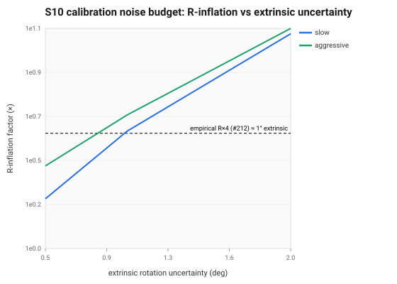
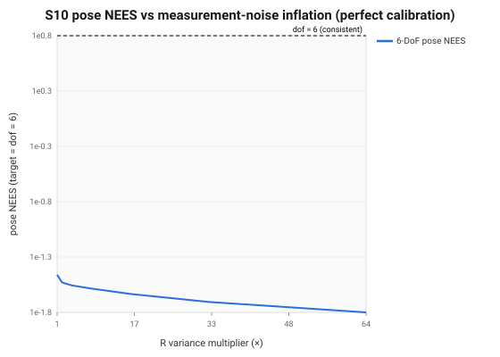

import { Aside } from '@astrojs/starlight/components';

The camera and IMU are two rigidly-attached sensors. Fusing them requires knowing
**exactly** how they're mounted relative to each other (the extrinsic transform
`T_CI`), how the lens maps rays to pixels (intrinsics + distortion), and how their
clocks line up (the time offset `t_d`). S10 is about whether the filter treats
those numbers as *estimated state with uncertainty* — or as *perfectly known
constants*. The cortex filter does the latter, and this page is the measured case
that doing so is a leading contributor to the filter being over-confident.

## What it does

OpenVINS carries the calibration as **state**, alongside the pose and biases:

- **Extrinsics** `T_CI ∈ SE(3)` — 6 parameters per camera.
- **Intrinsics + distortion** — 8 parameters per camera (radtan).
- **Time offset** `t_d` — 1 parameter per camera.

Their Jacobians enter the measurement Jacobian `H_x` of the [MSCKF
update](../overview.mdx), so the filter both *corrects* them online and, more
importantly, **carries their uncertainty**. The principle is unconditional: even a
filter that does **not** estimate calibration online must still account for its
uncertainty — by inflating the measurement noise `R`, or carrying a fixed prior
block — or it treats imperfect calibration as perfect and becomes over-confident.

## Why it matters

This is the crux of [#212](../engineering-status.mdx). By default the cortex MSCKF has
**no calibration states and no calibration term in the noise budget** — the EuRoC
`T_CI` is taken as truth. Any real mounting error then has nowhere to go: the
filter can't estimate it away and doesn't widen its covariance for it, so the
resulting reprojection error is **silently absorbed into the state** while the
covariance stays tight. That is the textbook recipe for over-confidence.

## The contract

| | |
|---|---|
| **Signature** | calibration as state: `T_CI` (6/cam), intrinsics+distortion (8/cam), `t_d` (1/cam) |
| **What it does** | estimates calibration online (its Jacobians enter `H_x`); or, if fixed, accounts for its uncertainty in `R` |
| **Post / invariants** | *if estimated:* calibration states observable only under sufficient excitation (like accel bias) · *if fixed:* the assumed-perfect calibration's true uncertainty must appear **somewhere** in the noise budget |
| **cortex** | **extrinsics only, off by default** — `VioConfig::estimate_extrinsics` (default `false`, #332) adds one 6-DoF `CalibState` block (`R_imu_cam`, `p_imu_cam`) per camera with a prior; `calib_ext_rot_sigma_deg` (default 0) is the alternative `R` term. No intrinsics or `t_d` states. With both off (the default), `T_CI`/`t_d`/intrinsics are treated as perfectly known |

## Metrics

The [S10 probe](../engineering-status.mdx) measures the hypothesis two ways —
an analytic budget and an end-to-end sweep on the **real backend**.

### 1. Analytic noise budget — what unmodeled calibration costs in pixels

Given a realistic calibration uncertainty, compute the reprojection error it
induces and the equivalent `R`-inflation. The filter assumes ~**4.6 px** of image
noise; a single degree of extrinsic error already exceeds that:

| Extrinsic σ (gentle motion) | induced reprojection | equivalent `R` inflation |
|---|---|---|
| 0.5° | 4.1 px | 1.8× |
| **1.0°** | **8.1 px** | **4.1×** |
| 2.0° | 16 px | 13.2× |



A 1° extrinsic error (entirely realistic for a hand-measured rig) induces ~8 px —
nearly **double** the assumed noise — for an `R`-inflation of ~**4×**. That number
is not a coincidence: it's the same `R×4` the EuRoC troubleshooting found restores
consistency.

### 2. End-to-end R-inflation sweep — the perfect-calibration control

On the synthetic world with **perfect calibration and clean sensors**, the backend
is **not** over-confident: pose NEES sits below dof = 6 at `R`×1, and inflating the
measurement-noise variance `R` only makes it more pessimistic:

| `R` scale | pose NEES (target 6) | ATE |
|---|---|---|
| ×1 | **0.036** | 2.3 cm |
| ×4 | 0.029 | 1.6 cm |
| ×16 | 0.024 | 1.8 cm |
| ×64 | 0.016 | 2.5 cm |



This sweep once showed **NEES ≈ 43 at R×1** (ATE 0.63 m), almost exactly the EuRoC
MH_05 value, and was read as the clean setup reproducing the real over-confidence.
It was a synthetic artifact: the world left its warm-up with a ≈1 m/s velocity
step that no accelerometer sample recorded (#475, fixed in #537). With the world
corrected, the perfect-calibration control is consistent, so the EuRoC
over-confidence (#212) needs something the clean world lacks: unmodeled
calibration uncertainty (the budget above), process noise, low parallax, or the
real-data clone drift that drives the yaw leak.

## Run the probe

Both measurements come from **`s10_online_calibration`**
(`tools/src/s10_online_calibration.cpp`), which drives
`sdk/include/branes/sdk/eval/calibration_probe.hpp`:

```bash
cmake --build build -j$(nproc) --target s10_online_calibration
./build/tools/s10_online_calibration --help    # print the S10 contract and exit
./build/tools/s10_online_calibration --no-out  # compute and print only, no files
./build/tools/s10_online_calibration --out DIR # write the CSVs to DIR
```

```text
R-inflation @ 1deg ext, slow          4.1  x   induced 8.1px vs assumed 4.6px
pose NEES with perfect calibration    0.036    below dof: the clean control is consistent
```

| Tool | Location | Purpose |
|---|---|---|
| Calibration probe | `tools/src/s10_online_calibration.cpp` + `eval/calibration_probe.hpp` | `noise_budget(...)` (pixels → `R` inflation) and `r_inflation_sweep()` (the NEES sweep) |
| Jacobian test | `tests/sdk/calib_jacobians.cpp` | finite-difference check of the online-calibration Jacobians |
| Recovery test | `tests/sdk/calib_recovery.cpp` | online calibration drives a deliberately wrong extrinsic back to truth |

The online estimator is `VioConfig::estimate_extrinsics`
(`sdk/include/branes/sdk/vio_backend.hpp`), with the priors
`calib_ext_rot_prior_deg` (1.0) and `calib_ext_trans_prior_mm` (10.0); the state
block is `CalibState` and `enable_calibration(init, rot_sigma, trans_sigma)` in
`sdk/include/branes/sdk/msckf/state.hpp`. Its measurement Jacobians,
$\mathbf{H}_{\theta,ic} = [\mathbf{p}_c]_\times$ and
$\mathbf{H}_{p,ic} = -\mathbf{R}_{ic}^\top$, are in `camera_updater.hpp::project()`.

There is no YAML or daemon config yet: calibration values are hardcoded in the
tools and tests, or set by environment variables in the EuRoC test
(`tests/sdk/vio_euroc.cpp`): `CORTEX_ESTIMATE_EXTRINSICS`,
`CORTEX_CALIB_ROT_PRIOR_DEG`, `CORTEX_CALIB_ROT_SIGMA_DEG`. The unified config path
is a separate epic ([#69](https://github.com/branes-ai/cortex/issues/69)). The
[stage bench](../../debugging/stage-benches.mdx#calibration-as-known-as-noise-or-as-state-s10)
`s10_online_calibration_bench` compares the three treatments over one window.

## Real-data inspector (`s10_inspect`)

The probe above measures the *cost* of treating calibration as perfectly known.
The real-data companion, **`s10_inspect`**, exercises the **other** S10 path — the
shipped online extrinsic estimator (`estimate_extrinsics`) that carries the
camera↔IMU extrinsic as state and refines it. It runs the real estimator over a
real EuRoC sequence seeded from a **deliberately perturbed** extrinsic, and tracks
the in-state estimate converging toward the dataset's true calibration. No SDK
change — `backend().state()` exposes the `CalibState` block.

```bash
s10_inspect --dataset /path/to/V1_01_easy/mav0 --out build/s10 --perturb-rot-deg 2 --perturb-trans-mm 30
node docs-site/scripts/gen-calibration-figures.mjs build/s10   # → calib_convergence.svg
```

It writes `calibration.json` and renders the **convergence figure**: the
extrinsic-rotation error (deg) and translation error (mm) over time, each inside
the filter's own ±3σ band, decaying toward the reference (0 error). Seeded a couple
of degrees / centimetres off, a healthy filter pulls the estimate back to truth
while the band shrinks — the in-state remedy for the unmodeled-calibration
over-confidence the probe quantifies. The per-frame error/σ read is unit-tested,
and `calib_recovery` proves the operator converges on physically-consistent data.

## Interactive

The covariance ellipsoid in the **[3-D viewer](../../vio/scene3d.mdx)** is this stage made
visible: on the sample run the reported position σ collapses to ~13 cm while the
true error grows past 2 m. An ellipsoid the ground-truth marker escapes from *is*
the missing calibration uncertainty.

<Aside type="caution" title="Status">
  **Leading contributor — measured, not the whole story.** The analytic budget and
  the end-to-end sweep agree that calibration uncertainty cleanly accounts for the
  **`R×4` component** of the #212 over-confidence (1° extrinsic ≈ 8 px ≈ R×4, both
  analytically and in magnitude). But R-*only* inflation needs ~**×32** to fully
  restore NEES — more than ×4 — because the empirical MH_05 fix paired R×4 with
  Q×10, so `R` alone has to do both jobs. **Calibration is one contributor; the
  rest is process noise (Q) and the S5 no-parallax-gate effect.** The principled
  fix is to **model** the uncertainty — estimate `T_CI`/`t_d` online
  (OpenVINS/MINS-style) or add a calibration term to `R` — not a blunt global
  `R`-scale. Tracked, with the full decomposition, on
  [Engineering Status](../engineering-status.mdx).
</Aside>
