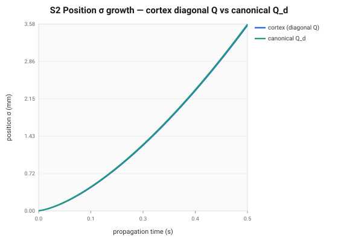
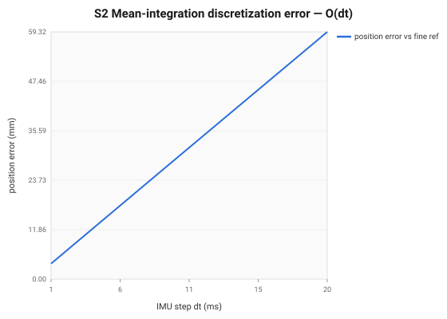
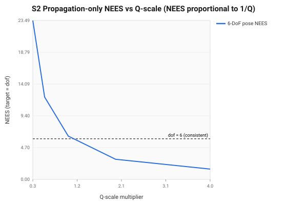

import { Aside } from '@astrojs/starlight/components';

Between camera frames the IMU runs at 200 Hz–1 kHz, and S2 integrates it: it
strapdown-integrates the **mean** (attitude, velocity, position) and propagates the
**covariance** `P` forward, so the filter arrives at the next image with both a
predicted pose and an honest uncertainty about it. This stage was a prime suspect
for the [#212 over-confidence](../engineering-status.mdx) — and the probe
**cleared it**. This page is what a measured *negative* result looks like.

## What it does

- **Mean** — integrate each IMU interval from **both** of its samples: debias, interpolate
  the input linearly between the samples at t₍ₖ₋₁₎ and tₖ, and integrate `R, v, p` by RK4
  (#616). An image between two samples is reached by holding the last sample; the next sample
  integrates the rest of its interval from the rate interpolated at the image time.
- **Covariance** — `P⁻_{k+1} = Φ P⁺_k Φᵀ + Q_d`. The transition matrix `Φ` carries
  the **off-diagonal skew blocks** coupling orientation error into velocity and
  position error — gravity leakage living inside the covariance. The discrete noise
  `Q_d` should map measurement-space noise through the noise Jacobian `G`, producing
  `θ–v–p` cross-correlations and the higher-order `Δt²/Δt³` scalings — **not** a
  plain diagonal.

## Why it was a suspect

The cortex `Q_d` is assembled **diagonally** — it drops the canonical position-noise
block and the velocity–position cross term. A diagonal `Q_d` understates
position/velocity process noise and omits correlations the update relies on, which
is a textbook over-confidence mechanism. The question is not "is it diagonal" (it
is) but **how much does that actually cost** — and the only honest way to answer is
to measure it against a canonical reference.

## The contract

| | |
|---|---|
| **Signature** | `propagate(x⁻, P⁻, imu[t_k, t_{k+1}]) → (x⁻_{k+1}, P⁻_{k+1})` |
| **Pre** | `Δt > 0`, monotonic timestamps; measurements debiased; `P⁺_k` symmetric PSD |
| **Post / invariants** | `R ∈ SO(3)` (orthonormal, det 1) · `P⁻` symmetric PSD · `Q_d` PSD with `θ–v–p` cross-correlations · the 4-D unobservable subspace (global position + yaw) stays in the propagation null space · GT-injection: zero-noise propagation closes on a continuous truth over a clone window within what the camera resolves (1.09e-4 rad, 0.22 mm at 2 m), at second order |
| **cortex** | `msckf/stages/s2_propagation.hpp` (the convention), `msckf/propagator.hpp` (`ImuInterval`, `rk4_strapdown`, Φ, Q) |

## Metrics

The [S2 probe](../consistency-analysis.mdx) reconstructs the canonical `Φ`/`Q_d`
and compares them to the shipped `Propagator`, then drives the **real** propagator
on the synthetic world.

### Φ reconstruction & the structural invariants — all pass

| check | result |
|---|---|
| Φ reconstruction (real == reference) | 1.5e-16 — **pass** |
| `R` orthonormality `‖RᵀR − I‖` @0.5 s | 2.2e-16 — **pass** |
| `P` min-eigenvalue @0.5 s | > 0 — **PSD** |
| global-position nullspace leak | 0 — **preserved** |
| GT-injection integrator order | O(Δt) (error halves with Δt: 59→30→15→7 mm @ 50→800 Hz) — **this was #616's defect**, see below |

<Aside type="caution" title="The row that should have failed">
  First order means the error halves with the step. For an integrator that should be second order
  or better, that is a defect, not a property: each interval held one sample constant, the one
  that ends it, which integrates the IMU half a sample (2.5 ms) early against the camera. The probe
  measured it in June 2026 and recorded it as a metric with no bound, so nothing failed. It was
  found in November by the consistency gate's spline truth (#613), and fixed in #616. The full
  account is [Aligning Sensor Samples](../../first-principles/sample-alignment.mdx).
</Aside>

### The diagonal-Q deficit — real, but small

The cortex `Q_d` does drop terms — but measured against the canonical `G Q_meas Gᵀ`,
the cost is minor:

| quantity | cortex vs canonical |
|---|---|
| Q θ-σ, Q v-σ | **match** |
| Q position term | 0 vs 3.06e-6 m — **dropped** |
| Q v–p cross term | 0 vs 1.25e-9 — **dropped** |
| Q relative-Frobenius gap | **0.35%** of Q dropped |
| position-σ under-report @0.05 s (inter-frame) | **7.4%** |
| position-σ under-report @0.5 s | **0.7%** |




### Propagation-only NEES — consistent at the default Q

Driving the real propagator and scaling `Q`, the propagation-only 6-DoF pose NEES
sits **right at its target** with the shipped noise:

| Q scale | pose NEES (target 6) |
|---|---|
| 0.25 | 23.5 |
| 0.5 | 12.2 |
| **1 (shipped)** | **6.4** |
| 2 | 2.97 |
| 4 | 1.52 |



At the default `Q`, NEES ≈ 6.4 ≈ the 6-DoF target — **the propagated covariance is
essentially honest on its own.**

## Real-data inspector (`s2_inspect`)

The measurements above come from the *synthetic* probe — known IMU, known Q, run
in CI. Its real-data companion, **`s2_inspect`**, runs the **real propagator**
(`msckf::Propagator`) over a real EuRoC IMU window. It seeds the prior pose+velocity
from ground truth at the window start (plus the filter's initial-P seed), then
propagates step by step — no SDK change, since the propagator is already standalone.

```bash
s2_inspect --dataset /path/to/V1_01_easy/mav0 --out build/s2 --window-s 0.5
node docs-site/scripts/gen-propagation-figures.mjs build/s2   # → cov_growth.svg, pose_drift.svg
```

It writes `propagation.json` and renders two figures:

- **the covariance-growth heatmap** — each of the 15 IMU error states' σ over the
  window (row-normalized), with the θ/p/v/b_g/b_a blocks marked. The position block
  growing only via the velocity coupling (no direct position-Q term) is the
  diagonal-`Q` simplification, now visible on real data.
- **drift vs the ±3σ envelope** — the propagated pose's dead-reckoning drift from
  ground truth, plotted against the filter's *own* growing 3σ band. Drift that
  stays inside the band means the propagated covariance honestly covers the error;
  drift that escapes it (red) is the local, real-data image of an under-noised `Q`.

This is the real-data check on the synthetic finding below: on EuRoC the envelope
covers the inter-frame drift, confirming propagation is essentially honest on its
own — the #212 over-confidence enters elsewhere.

## The mean: integrating from both samples (#616)

The probe above cleared S2's **covariance**. Its **mean** carried a defect the probe measured and
nobody bounded. Both backends held one IMU sample over each 5 ms interval, and they held different
ones: `MsckfBackend` the sample that ends the interval, `InvariantVioBackend` the one that starts
it. Either is a half-sample (2.5 ms) skew between IMU and camera. On the EuRoC consistency gate,
with exact R and Q from one spline truth, NIS was 1.00 on the slow sequences and 1.1–1.9 on the
fast ones (V1_03, V2_02, V2_03).

The closure test (`tests/tools/gt_spline.cpp`) integrates a spline's own noise-free IMU over a
0.55 s clone window on a flight that rolls and pitches at about 1.3 rad/s, against what the camera
resolves (a tenth of 0.5 px: 1.09e-4 rad, 0.22 mm at 2 m):

| Scheme | Rotation ÷ bound | Position ÷ bound | Order |
|---|---|---|---|
| End sample held, Euler (MSCKF before #616) | 28.6 | 41 | first |
| Start sample held, Euler (R-IEKF before #616) | 28.0 | 6.9 | first |
| The two samples' average, Euler | 0.28 | 24 | first in position |
| **The line between the samples, RK4 (shipped)** | **0.27** | **0.10** | **second** |

Centring the input removes the rotation error. The position error is the integrator's: an Euler
step rotates the specific force with the attitude at the start of the interval. RK4 rotates it
along the interval.

**Φ followed the mean.** #471 found that a higher-order Φ leaks more yaw than the first-order
I + A·Δt. That was true against the one-sample Euler mean, which the first-order Φ approximately
linearizes. Against the RK4 mean the first-order Φ leaks 7× more than it used to (4.4e-6 per step
at 2.5 ms, from 6.0e-7), so the lesson was about the agreement between Φ and the mean, not about
truncation. The RK4 mean has the preintegration form R′ = R·ΔR, v′ = v + gΔt + R·Δv,
p′ = p + vΔt + ½gΔt² + R·Δp, which a rotation about gravity commutes with. Φ is now that mean's
exact Jacobian, and it preserves the whole unobservable subspace, yaw included, to roundoff
(`tests/sdk/imu_interval.cpp` checks it against finite differences).

<Aside type="tip" title="Status — covariance cleared; mean fixed in #616">
  S2 is **not** a primary source of the #212 over-confidence. The diagonal-`Q`
  simplification is real but costs &lt;1% of position-σ over a frame, every
  structural invariant passes, and propagation-only NEES is consistent at the
  shipped noise. This also **sharpens** the
  [Consistency Analysis](../consistency-analysis.mdx) finding that "Q×10 helps
  on EuRoC": that is *compensating inflation* widening `P` to mask the structural
  error elsewhere — not evidence that propagation is genuinely under-noised.
  Outstanding (correctness, not consistency): add the dropped `Q_d` position and
  v–p cross terms. Full decomposition on
  [Engineering Status](../engineering-status.mdx).
</Aside>
